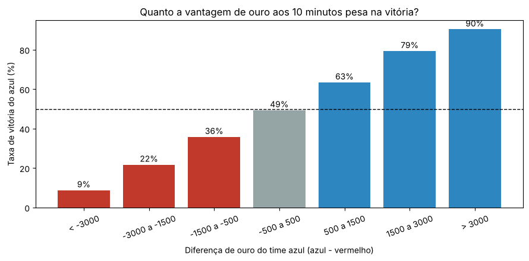
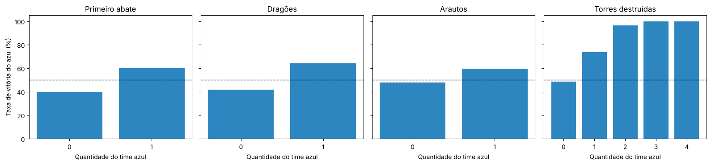
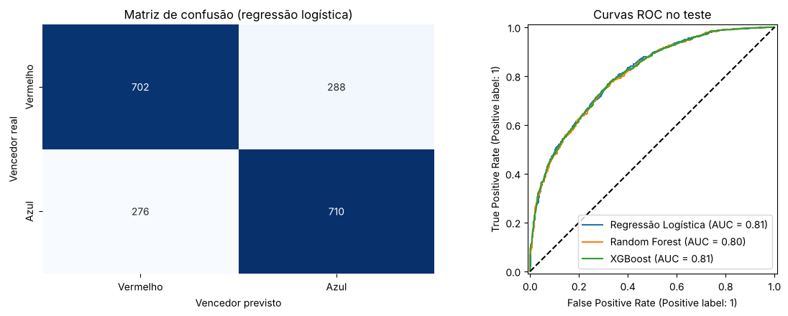
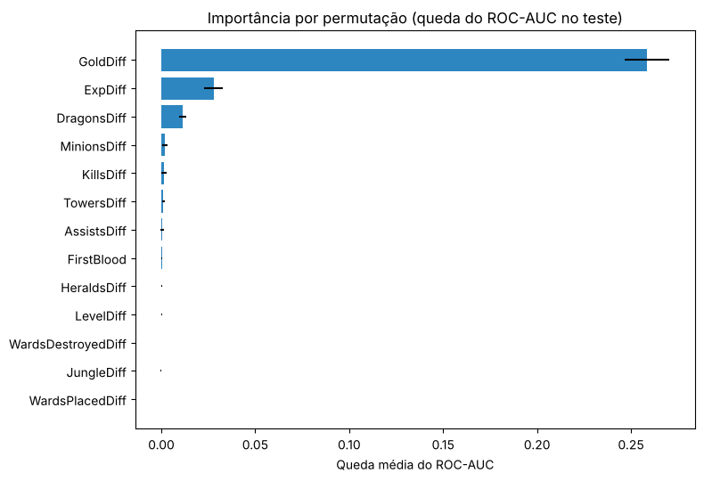
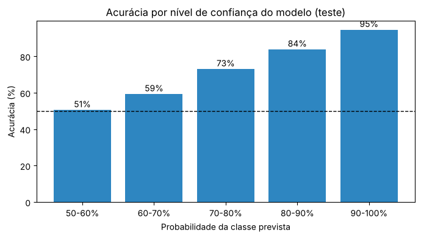

# Prevendo a vitória em partidas ranqueadas de League of Legends

Projeto de classificação binária que prevê qual time vence uma partida ranqueada de League of Legends usando apenas o que aconteceu nos **10 primeiros minutos**. Desenvolvido como projeto final do módulo 43 do curso Profissão: Cientista de Dados (EBAC).



## Problema de negócio

Uma plataforma de e-sports, um time ou um comentarista quer saber, logo no início da partida, qual lado tem mais chance de vencer. Essa previsão permite mostrar a probabilidade de vitória ao vivo, ajudar o treinador a decidir quando arriscar ou jogar com segurança e identificar quais vantagens iniciais realmente pesam no resultado.

- **Tarefa de ML:** classificação binária supervisionada.
- **Alvo:** `blueWins` (1 = o time azul venceu, 0 = o time vermelho venceu).
- **Métricas:** as classes são equilibradas (50,1% / 49,9%), então uso acurácia, ROC-AUC, F1-score e matriz de confusão.

## Dados

| Item | Descrição |
|---|---|
| Base | LOL Ranked Win (partidas ranqueadas de League of Legends), fornecida no módulo 43 do curso |
| Tamanho | 9.879 partidas e 40 colunas, todas numéricas |
| Qualidade | Sem valores ausentes, sem linhas duplicadas, sem `gameId` repetido |
| Momento da medição | Todas as variáveis são medidas até o minuto 10; o alvo é o resultado final (não há vazamento do futuro) |

O arquivo está em `data/Base_M43_Pratique_LOL_RANKED_WIN.csv`.

## A armadilha da base

A base mostra a mesma partida duas vezes, do ponto de vista do time azul e do vermelho. Por isso **11 das 40 colunas são cópias exatas ou cálculos diretos de outras**: `redGoldDiff = -blueGoldDiff`, `redKills = blueDeaths`, `redFirstBlood = 1 - blueFirstBlood`, `EliteMonsters = Dragons + Heralds` e as colunas por minuto (`GoldPerMin`, `CSPerMin`), que são o total dividido por 10.

Usar todas as colunas geraria multicolinearidade perfeita. Tratei transformando cada par azul/vermelho em **uma única variável de diferença** (azul - vermelho), o que deixa 13 variáveis independentes e interpretáveis.

## Análise exploratória

Oito técnicas: distribuição do alvo, estatísticas descritivas e outliers, distribuições por resultado, correlações, análise de redundância, taxa de vitória por evento do jogo, testes estatísticos (Mann-Whitney e qui-quadrado, com tamanho de efeito) e taxa de vitória por faixa de ouro. Principais achados:

- A diferença de ouro aos 10 minutos é o fator dominante (correlação de 0,51 com a vitória). Com mais de 3000 de vantagem, o time vence **90%** das partidas; com mais de 3000 de desvantagem, **9%**.
- Primeiro abate (59,9% contra 39,7%), dragão (64,1% contra 41,9%) e torre (73,7%, mas só em 429 partidas) mudam a chance de vitória em 20 a 25 pontos percentuais.
- Sentinelas colocadas são estatisticamente significativas (p = 0,00001), mas com tamanho de efeito nulo (d = 0,00): significância não é relevância prática.
- O jogo não está decidido aos 10 minutos: com 1500 a 3000 de vantagem, 21% das partidas ainda são perdidas.



## Modelagem

- Divisão estratificada 80/20 (`random_state=42`) feita **antes** de qualquer padronização; o `StandardScaler` fica dentro de um `Pipeline` e é ajustado só com o treino.
- Comparação de uma regra simples (apostar no time com mais ouro) com regressão logística, Random Forest e XGBoost, por validação cruzada estratificada de 5 partes.
- Ajuste de hiperparâmetros com `GridSearchCV` (regressão logística) e `RandomizedSearchCV` (Random Forest e XGBoost), otimizando ROC-AUC.
- O conjunto de teste foi usado uma única vez, no final.

| Modelo | ROC-AUC (validação cruzada) | Acurácia (teste) | ROC-AUC (teste) |
|---|---|---|---|
| Regra simples (ouro > 0) | - | 71,8% | - |
| Regressão logística | 0,812 | 71,5% | 0,807 |
| Random Forest | 0,808 | 72,0% | 0,804 |
| XGBoost | 0,809 | 72,1% | 0,806 |

Os três modelos **empatam** (a diferença está dentro do erro-padrão de cerca de 1 ponto percentual com 1.976 partidas de teste) e a regra de uma linha já acerta 71,8%. Escolhi a regressão logística pela validação cruzada: é a mais simples, explicável e pode rodar ao vivo.



## Interpretação

- **Importância por permutação:** `GoldDiff` derruba o ROC-AUC em 0,26 ao ser embaralhada; `ExpDiff` em 0,03 e `DragonsDiff` em 0,01. As demais ficam perto de zero.
- O ouro e a experiência medem o quanto um time está mais forte que o outro; abates, dragões, torres e minions são o caminho para ganhá-los, por isso o modelo quase não precisa deles.
- Coeficientes negativos pequenos (abates, minions) refletem correlação entre variáveis explicativas e não um efeito real.



## Recomendação de negócio

O modelo sabe quando está em dúvida: com confiança de 50 a 60% ele acerta 51% (praticamente um palpite); acima de 80% ele acerta de 84% a 95%, e isso acontece em cerca de **37% das partidas**.

1. **Transmissões e plataformas:** mostrar a probabilidade ao vivo, mas destacá-la apenas quando a confiança passa de 80%.
2. **Times e treinadores:** foco em ouro e experiência nos primeiros 10 minutos; quem está atrás por menos de 1500 ainda tem a partida em aberto e deve jogar para virar.
3. **Produto de análise:** começar pela regra de ouro e experiência, que tem o mesmo desempenho; o modelo só se justifica para informar a confiança de cada previsão.



## Limitações e próximos passos

- Só os 10 primeiros minutos: a previsão tem um teto natural (~72%).
- Faltam campeões escolhidos, composição do time, nível dos jogadores e posição no mapa, que provavelmente explicam as viradas.
- A base não informa o elo nem a versão (patch) do jogo.
- Repetir a análise em outros minutos (5, 15, 20) para ver como a confiança cresce.

## Como executar

```bash
ggit clone httpsgithub.comlumagnaniLoL-Ranked-Win-Prediction.git
cd LoL-Ranked-Win-Prediction
pip install -r requirements.txt
jupyter notebook notebooks/lol_ranked_win.ipynb
```

## Estrutura

```
├── data/Base_M43_Pratique_LOL_RANKED_WIN.csv
├── images/
├── notebooks/lol_ranked_win.ipynb
├── requirements.txt
└── README.md
```

## Tecnologias

Python, pandas, NumPy, Matplotlib, Seaborn, SciPy, scikit-learn, XGBoost.
